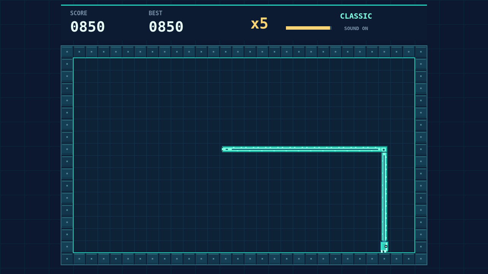

# Coil

A bright serpent wakes inside a walled grid. It never stops moving. Choose each turn before the next beat and keep its head clear of the walls and its own trail.

Eat a pink pellet to add one cell to the coil. Each extra segment leaves less open ground, making every route through the board a little more delicate.

The best scores come from rhythm. Reach another pellet before the combo bar empties to build the multiplier, then keep threading your way to the next one. Hesitate too long and the multiplier returns to one.

Play Classic for a clean, open arena. Use the arrow keys or W A S D to steer, P or Escape to pause, and M to toggle sound.

